# Lab6Web — Praktikum 6: JavaScript DOM dan Event Handling

| | |
|---|---|
| **Nama** | Sairin Bin Rubad |
| **NIM** | 312510134 |
| **Mata Kuliah** | Pemrograman Web |
| **Pertemuan** | 7 — JavaScript DOM dan Event Handling |
| **Program Studi** | Teknik Informatika |

---

## 1. Tujuan Praktikum

1. Memahami DOM sebagai representasi dokumen HTML yang dapat diakses melalui JavaScript.
2. Menggunakan `id`, `class`, dan selector CSS untuk memilih elemen HTML.
3. Mengubah teks, atribut, kelas CSS, dan gaya elemen melalui JavaScript.
4. Menangani event pengguna menggunakan `addEventListener()`.
5. Membuat validasi form dan menampilkan pesan sesuai kondisi input.
6. Mengembangkan halaman interaktif dengan minimal tiga fungsi yang berjalan benar.

## 2. Struktur File

```
Lab6Web/
├── index.html               # halaman menu (buka ini di browser)
├── README.md
├── lab6_dom_event/          # Latihan 1 - 6 + Eksperimen Mandiri
│   ├── index.html
│   ├── style.css
│   └── script.js
├── mini_project/            # Form Pendaftaran Workshop
│   ├── index.html
│   ├── style.css
│   └── script.js
└── screenshots/             # Seluruh screenshot hasil (dipakai di README ini)
```

## 3. Cara Menjalankan

1. Ekstrak file ZIP, lalu buka folder `Lab6Web`.
2. Buka `lab6_dom_event/index.html` (Latihan 1–6) atau `mini_project/index.html` (Mini Project) dengan browser modern (Chrome, Edge, atau Firefox). Bisa juga memakai ekstensi **Live Server** di Visual Studio Code.
3. Tekan **F12** untuk membuka Developer Tools › Console dan memastikan tidak ada error.

### Jika `script.js` tidak bisa dibuka / halaman tidak berfungsi

- **Jangan klik dua kali `script.js`.** Di Windows, file `.js` yang diklik dua kali dijalankan oleh *Windows Script Host* dan menghasilkan error (karena kode ini memakai `document`, yang hanya ada di browser). Yang dibuka di browser adalah **`index.html`**, bukan `script.js`.
- Untuk **melihat/mengedit** kode, klik kanan `script.js` › *Open with* › **Visual Studio Code** (atau Notepad).
- **Ekstrak ZIP dulu** (klik kanan › *Extract All*). Jika `index.html` dibuka langsung dari dalam ZIP, `script.js` dan `style.css` tidak ikut terbaca.
- Pastikan `index.html`, `style.css`, dan `script.js` berada dalam **satu folder** yang sama.
- Cara termudah: buka `index.html` di folder `Lab6Web` (halaman menu) lalu pilih Latihan atau Mini Project.

> Tidak diperlukan instalasi library apa pun. Semua kode memakai HTML, CSS, dan JavaScript murni.

---

## 4. Langkah Kerja, Syntax, dan Screenshot

Semua latihan digabung dalam satu halaman (`lab6_dom_event/index.html`) dengan `script.js` dihubungkan memakai atribut `defer` pada `<head>`, sehingga skrip berjalan setelah HTML selesai diparsing dan seluruh elemen sudah tersedia.

Tampilan keseluruhan halaman:

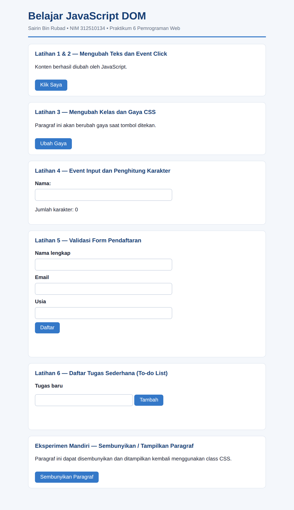

### Latihan 1 — Mengubah Teks dengan DOM

**Syntax (`script.js`)**

```js
const judul = document.getElementById("judul");
const pesan = document.getElementById("pesan");
judul.textContent = "Belajar JavaScript DOM";
pesan.textContent = "Konten berhasil diubah oleh JavaScript.";
```

**Penjelasan**

- `document.getElementById("judul")` mengambil elemen `<h1 id="judul">` dari DOM, lalu disimpan dalam konstanta `judul`. Hal yang sama dilakukan untuk paragraf `#pesan`.
- Properti `textContent` dipakai untuk mengganti isi teks elemen. Awalnya judul bertuliskan *"Latihan DOM"* dan paragraf *"Belum ada tindakan."*, tetapi saat halaman dimuat JavaScript mengubahnya.
- `textContent` memperlakukan nilai sebagai teks biasa (bukan markup HTML), sehingga aman.

**Hasil**

Judul berubah menjadi *"Belajar JavaScript DOM"*:

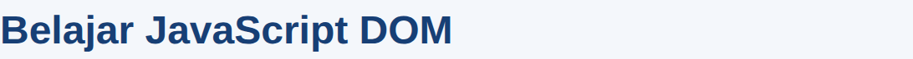

Paragraf berubah menjadi *"Konten berhasil diubah oleh JavaScript."*:

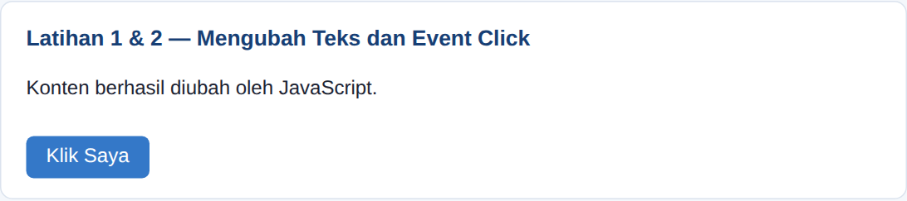

---

### Latihan 2 — Event Click

**Syntax**

```js
const tombol = document.getElementById("tombolAksi");
tombol.addEventListener("click", function () {
  pesan.textContent = "Tombol diklik pada " + new Date().toLocaleTimeString();
});
```

**Penjelasan**

- `addEventListener("click", fungsi)` menghubungkan event **click** pada tombol dengan sebuah fungsi. Fungsi hanya dijalankan ketika tombol ditekan.
- `new Date().toLocaleTimeString()` membuat objek waktu saat ini lalu mengubahnya menjadi teks jam (misalnya `14.07.31`).
- Setiap kali tombol ditekan, isi paragraf `#pesan` diperbarui dengan waktu terbaru.

**Hasil** (setelah tombol "Klik Saya" ditekan)

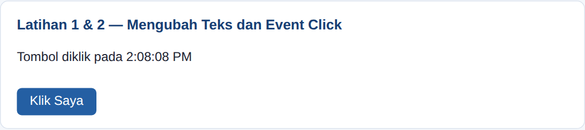

---

### Latihan 3 — Mengubah Kelas dan Gaya CSS

**Syntax CSS (`style.css`)**

```css
.highlight {
  color: #173f75;
  background-color: #e6f1ff;
  border-left: 4px solid #3478c8;
  padding: 12px;
}
.teks-besar { font-size: 1.4rem; }
```

**Syntax JavaScript**

```js
const tombolGaya = document.getElementById("tombolGaya");
const teksGaya = document.getElementById("teksGaya");
tombolGaya.addEventListener("click", function () {
  teksGaya.classList.toggle("highlight");
  teksGaya.classList.toggle("teks-besar");
});
```

**Penjelasan**

- Gaya dibuat di CSS dalam bentuk class (`.highlight` dan `.teks-besar`), sedangkan JavaScript hanya menambah/mencabut class tersebut. Cara ini lebih rapi daripada mengubah `style` satu per satu.
- `classList.toggle("nama")` menambahkan class jika belum ada, dan menghapusnya jika sudah ada. Jadi satu tombol dapat mengaktifkan dan menonaktifkan gaya.
- Perbedaan tiga method `classList`:
  - `add()` — hanya menambah class (tidak berubah jika sudah ada).
  - `remove()` — hanya menghapus class.
  - `toggle()` — saklar: tambah bila tidak ada, hapus bila ada.

**Hasil**

Sebelum tombol ditekan:

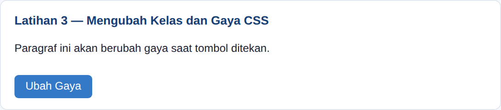

Sesudah tombol "Ubah Gaya" ditekan (muncul latar biru, garis kiri, dan ukuran huruf lebih besar):

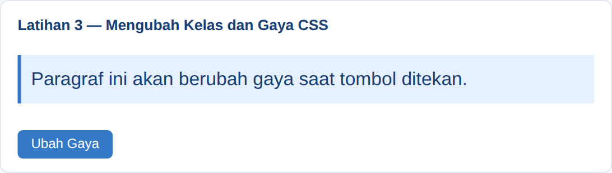

---

### Latihan 4 — Event Input dan Penghitung Karakter

**Syntax HTML**

```html
<label for="namaInput">Nama:</label>
<input type="text" id="namaInput" maxlength="40">
<p>Jumlah karakter: <span id="jumlahKarakter">0</span></p>
```

**Syntax JavaScript**

```js
const namaInput = document.getElementById("namaInput");
const jumlahKarakter = document.getElementById("jumlahKarakter");
namaInput.addEventListener("input", function () {
  jumlahKarakter.textContent = namaInput.value.length;
});
```

**Penjelasan**

- Event `input` terjadi setiap kali isi kolom berubah: saat mengetik, menghapus, maupun menempel (paste).
- `namaInput.value` berisi teks yang sedang diketik; `.length` menghitung jumlah karakternya. Hasilnya langsung ditulis ke `<span id="jumlahKarakter">`.
- Atribut `maxlength="40"` membatasi input maksimal 40 karakter.

**Hasil**

Kondisi awal (0 karakter):

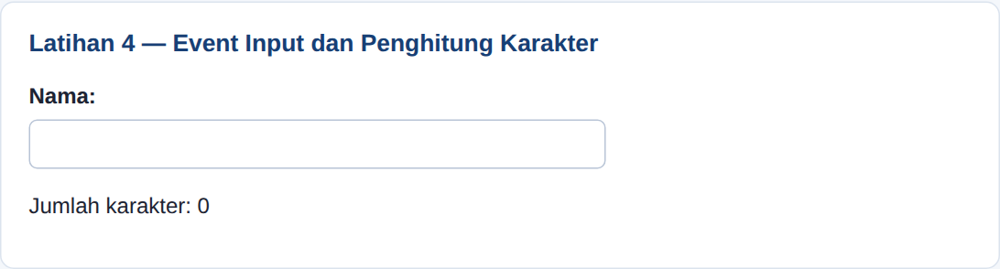

Setelah mengetik "Sairin Bin Rubad" (16 karakter):

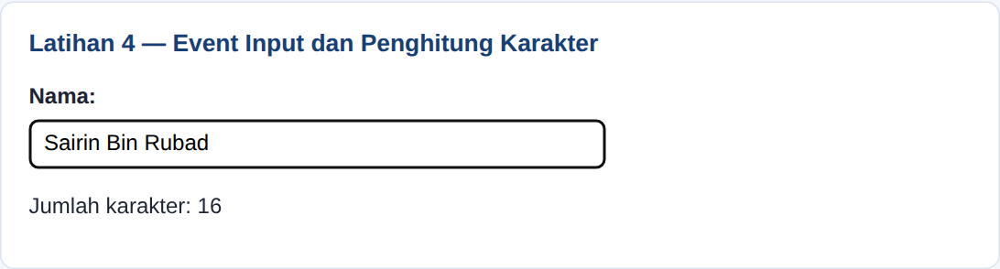

---

### Latihan 5 — Validasi Form Pendaftaran

**Syntax HTML**

```html
<form id="formPendaftaran" novalidate>
  <label for="nama">Nama lengkap</label>
  <input id="nama" name="nama" type="text">
  <label for="email">Email</label>
  <input id="email" name="email" type="email">
  <label for="usia">Usia</label>
  <input id="usia" name="usia" type="number" min="17" max="100">
  <button type="submit">Daftar</button>
</form>
<p id="pesanForm" aria-live="polite"></p>
```

**Syntax JavaScript**

```js
const form = document.getElementById("formPendaftaran");
const pesanForm = document.getElementById("pesanForm");
form.addEventListener("submit", function (event) {
  event.preventDefault();
  const nama = document.getElementById("nama").value.trim();
  const email = document.getElementById("email").value.trim();
  const usiaInput = document.getElementById("usia").value;
  const usia = Number(usiaInput);
  const polaEmail = /^[^\s@]+@[^\s@]+\.[^\s@]+$/;

  if (nama === "") {
    pesanForm.textContent = "Nama wajib diisi.";
  } else if (!polaEmail.test(email)) {
    pesanForm.textContent = "Masukkan email yang valid.";
  } else if (usiaInput === "" || !Number.isInteger(usia) || usia < 17 || usia > 100) {
    pesanForm.textContent = "Usia harus berupa bilangan bulat 17–100.";
  } else {
    pesanForm.textContent = "Validasi berhasil. Form siap diproses.";
    form.reset();
  }
});
```

**Penjelasan**

- `novalidate` pada `<form>` mematikan validasi bawaan browser agar validasi dilakukan oleh JavaScript kita sendiri.
- `event.preventDefault()` mencegah halaman dimuat ulang saat form dikirim, sehingga pemeriksaan dapat selesai dan pesan tampil.
- `.trim()` membuang spasi di awal/akhir agar isian yang hanya berisi spasi dianggap kosong.
- `polaEmail` adalah *regular expression*: harus ada teks, tanda `@`, teks, titik, lalu teks (tanpa spasi). `polaEmail.test(email)` menghasilkan `true` jika cocok.
- Usia diubah ke angka dengan `Number()`, lalu diperiksa tidak kosong, berupa bilangan bulat (`Number.isInteger`), dan berada pada rentang 17–100.
- Pemeriksaan memakai `if / else if` berurutan: nama → email → usia. Jika semua lolos, tampil pesan sukses dan form dikosongkan dengan `form.reset()`.
- `aria-live="polite"` membuat pembaca layar mengumumkan pesan baru, sehingga lebih ramah aksesibilitas.

**Hasil — lima kondisi pengujian**

1. Semua input kosong → *"Nama wajib diisi."*


2. Nama kosong (email dan usia terisi) → *"Nama wajib diisi."*

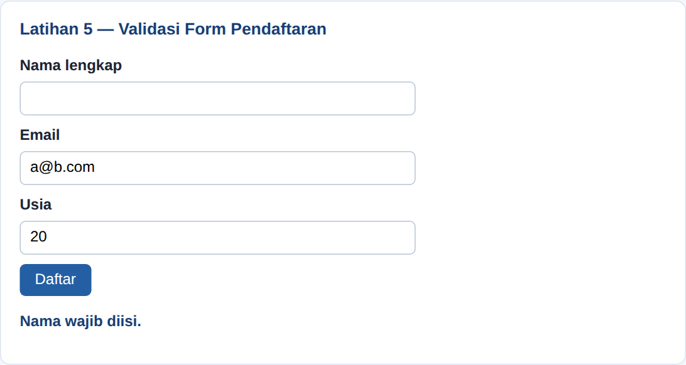

3. Email tidak valid (`sairin@`) → *"Masukkan email yang valid."*

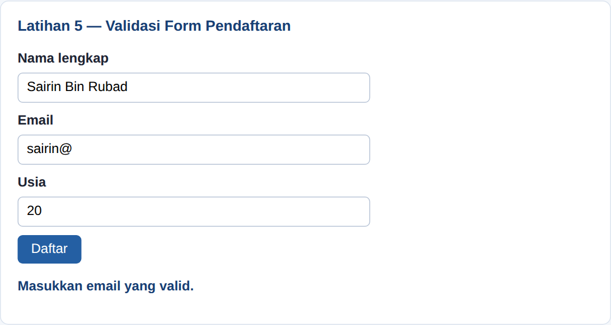

4. Usia di bawah 17 (usia 15) → *"Usia harus berupa bilangan bulat 17–100."*

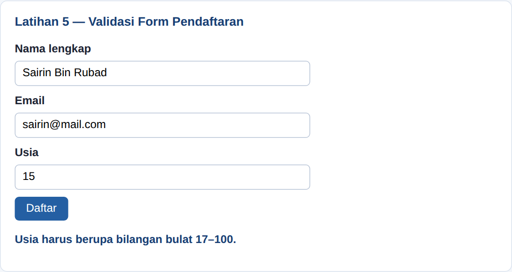

5. Semua input valid → *"Validasi berhasil. Form siap diproses."* (form otomatis dikosongkan)

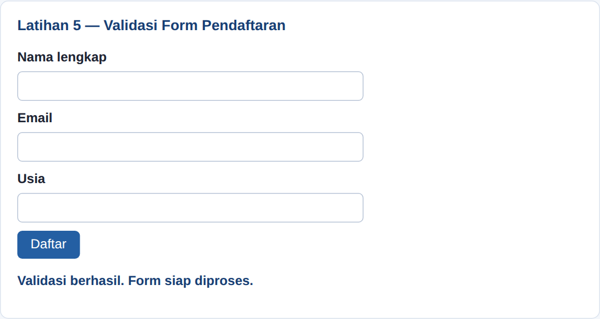

---

### Latihan 6 — Daftar Tugas Sederhana (To-do List)

**Syntax HTML**

```html
<section>
  <h2>Daftar Tugas</h2>
  <label for="inputTugas">Tugas baru</label>
  <input id="inputTugas" type="text">
  <button id="tambahTugas" type="button">Tambah</button>
  <p id="pesanTugas" aria-live="polite"></p>
  <ul id="daftarTugas"></ul>
</section>
```

**Syntax JavaScript**

```js
tambahTugas.addEventListener("click", function () {
  const teks = inputTugas.value.trim();
  if (teks === "") {
    pesanTugas.textContent = "Tulis tugas terlebih dahulu.";
    return;
  }
  const item = document.createElement("li");
  const label = document.createElement("span");
  const selesai = document.createElement("button");
  label.textContent = teks + " ";
  selesai.type = "button";
  selesai.textContent = "Tandai selesai";
  selesai.addEventListener("click", function () {
    item.classList.toggle("selesai");
    selesai.textContent = item.classList.contains("selesai")
      ? "Batalkan selesai" : "Tandai selesai";
  });
  item.append(label, selesai);
  daftarTugas.appendChild(item);
  inputTugas.value = "";
  pesanTugas.textContent = "Tugas ditambahkan.";
  inputTugas.focus();
});
```

**CSS**

```css
.selesai span { text-decoration: line-through; color: #687386; }
li { margin-bottom: 8px; }
```

**Penjelasan**

- Jika input kosong, tampil pesan peringatan dan fungsi dihentikan dengan `return`.
- `document.createElement()` membuat elemen baru (`<li>`, `<span>`, `<button>`) langsung lewat DOM.
- Teks tugas dimasukkan dengan `textContent`, bukan `innerHTML`, sehingga apa pun yang diketik pengguna ditampilkan sebagai teks biasa dan tidak dieksekusi sebagai HTML (mencegah XSS).
- `item.append(label, selesai)` menyusun isi `<li>`, lalu `daftarTugas.appendChild(item)` memasukkannya ke daftar `<ul>`.
- Tombol "Tandai selesai" memakai `classList.toggle("selesai")` sehingga teks tugas dicoret (via CSS) dan label tombol berganti.
- Setelah menambah: input dikosongkan dan `focus()` mengembalikan kursor ke kolom input agar pengguna bisa langsung menulis tugas berikutnya.

**Hasil**

Tombol Tambah ditekan saat input kosong:

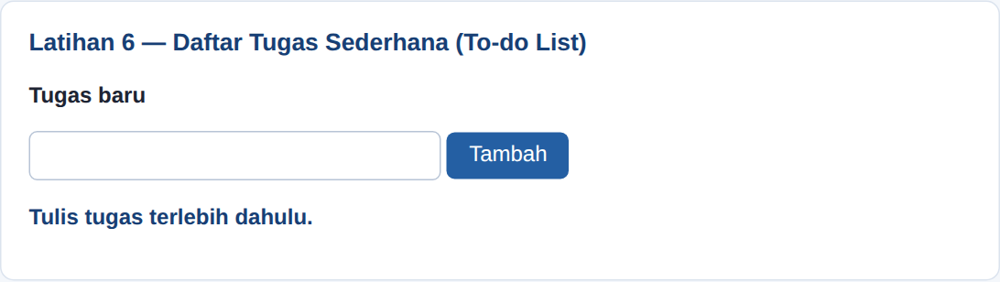

Tiga tugas berhasil ditambahkan:

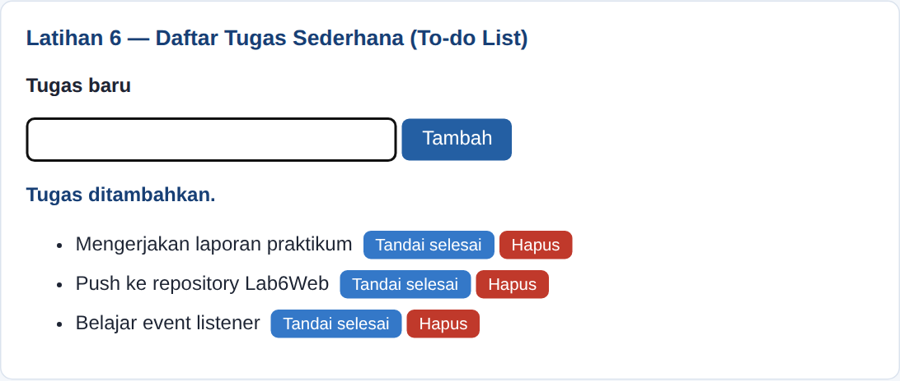

Tugas pertama ditandai selesai (dicoret, tombol berubah menjadi "Batalkan selesai"):

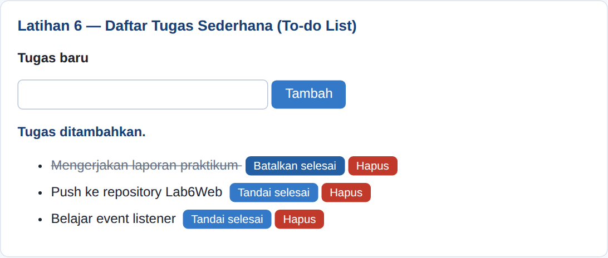

Tugas ketiga dihapus dengan tombol "Hapus" (Eksperimen Mandiri no. 1):

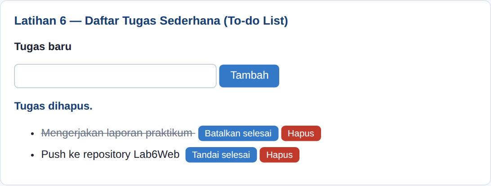

---

## 5. Mini Project — Form Pendaftaran Workshop

Lokasi: `mini_project/` (`index.html`, `style.css`, `script.js`).

**Fitur interaktif (lebih dari tiga):**

| No | Fitur | Event yang dipakai |
|----|-------|--------------------|
| 1 | Validasi nama (wajib, minimal 3 karakter), email (format), dan pilihan sesi | `submit` |
| 2 | Ringkasan input secara langsung di kartu sebelah kanan | `input`, `change` |
| 3 | Penghitung karakter kolom alasan (0/120) | `input` |
| 4 | Menampilkan sesi yang dipilih di bawah dropdown | `change` |
| 5 | Pesan kesalahan per kolom + pesan sukses/gagal | `submit` |
| 6 | Tombol Reset (mengosongkan form, pesan, dan ringkasan) | `click` |
| 7 | Tampilan responsif (desktop dan mobile) | CSS media query |

**Potongan syntax penting**

```js
// Validasi nama minimal 3 karakter (Eksperimen Mandiri no. 2)
function cekNama() {
  const v = namaEl.value.trim();
  let pesan = "";
  if (v === "") pesan = "Nama wajib diisi.";
  else if (v.length < 3) pesan = "Nama minimal terdiri dari 3 karakter.";
  tampilkanError(namaEl, errNama, pesan);
  return pesan === "";
}

// Event change pada dropdown sesi (Eksperimen Mandiri no. 3)
sesiEl.addEventListener("change", function () {
  perbaruiRingkasan();
  infoSesi.textContent = sesiEl.value ? "Sesi dipilih: " + sesiEl.value : "";
  if (errSesi.textContent) cekSesi();
});

// Submit: cek semua kolom, tampilkan pesan sukses atau gagal
form.addEventListener("submit", function (event) {
  event.preventDefault();
  const a = cekNama(), b = cekEmail(), c = cekSesi();
  if (a && b && c) { /* tampilkan pesan sukses */ }
  else { /* tampilkan pesan gagal */ }
});
```

**Penjelasan:** setiap kolom memiliki fungsi validasi sendiri (`cekNama`, `cekEmail`, `cekSesi`) yang mengembalikan `true/false` dan menampilkan pesan error di bawah kolom serta memberi border merah (class `invalid`). Saat submit, ketiganya dijalankan sekaligus (tidak berhenti di kesalahan pertama) agar pengguna melihat semua kesalahan sekaligus. Setelah kolom pernah salah, validasi dijalankan ulang ketika pengguna mengetik sehingga pesan hilang begitu isian diperbaiki.

**Hasil**

Tampilan awal:

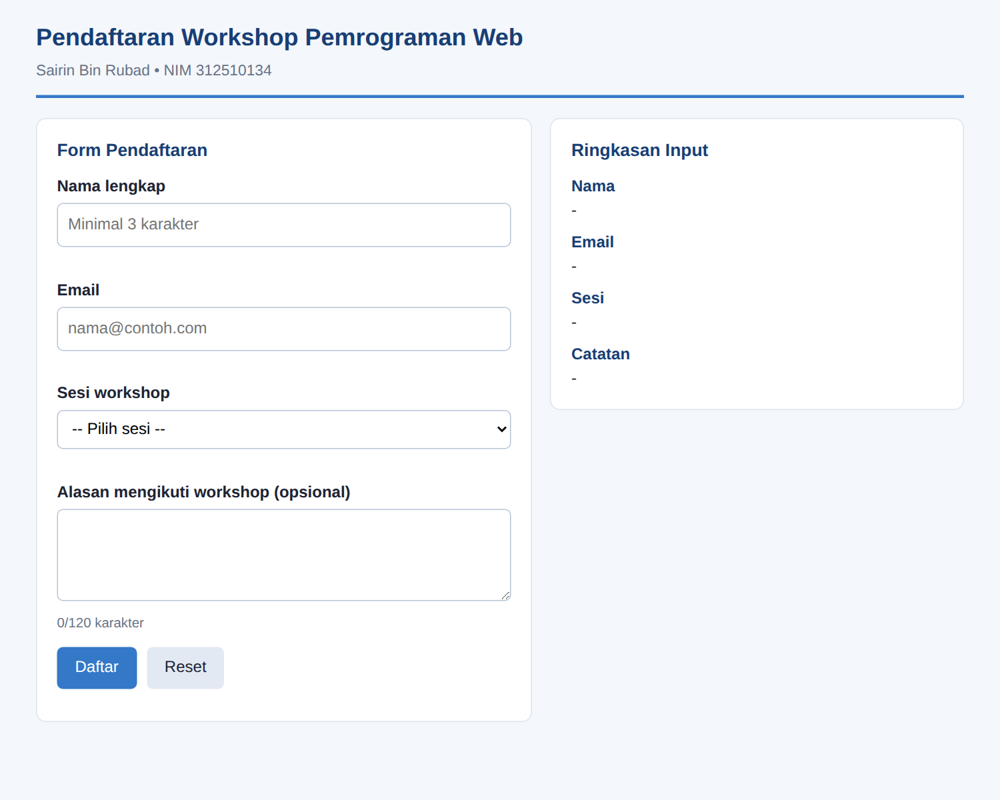

Submit dengan semua kolom kosong (pesan error muncul di tiap kolom):

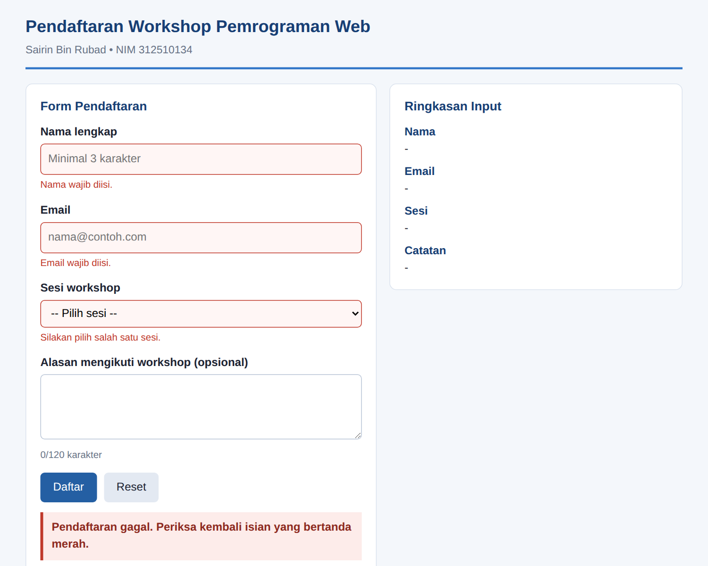

Nama terlalu pendek ("Si") dan email tidak valid:

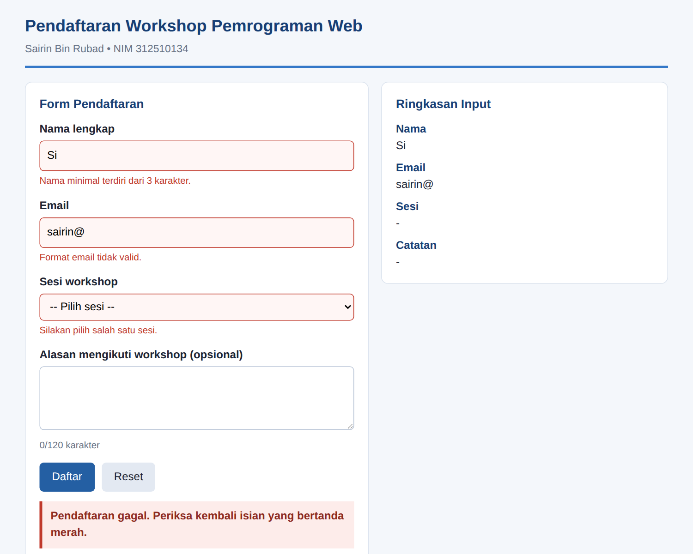

Pengisian valid — ringkasan input, sesi terpilih, dan penghitung karakter diperbarui langsung:

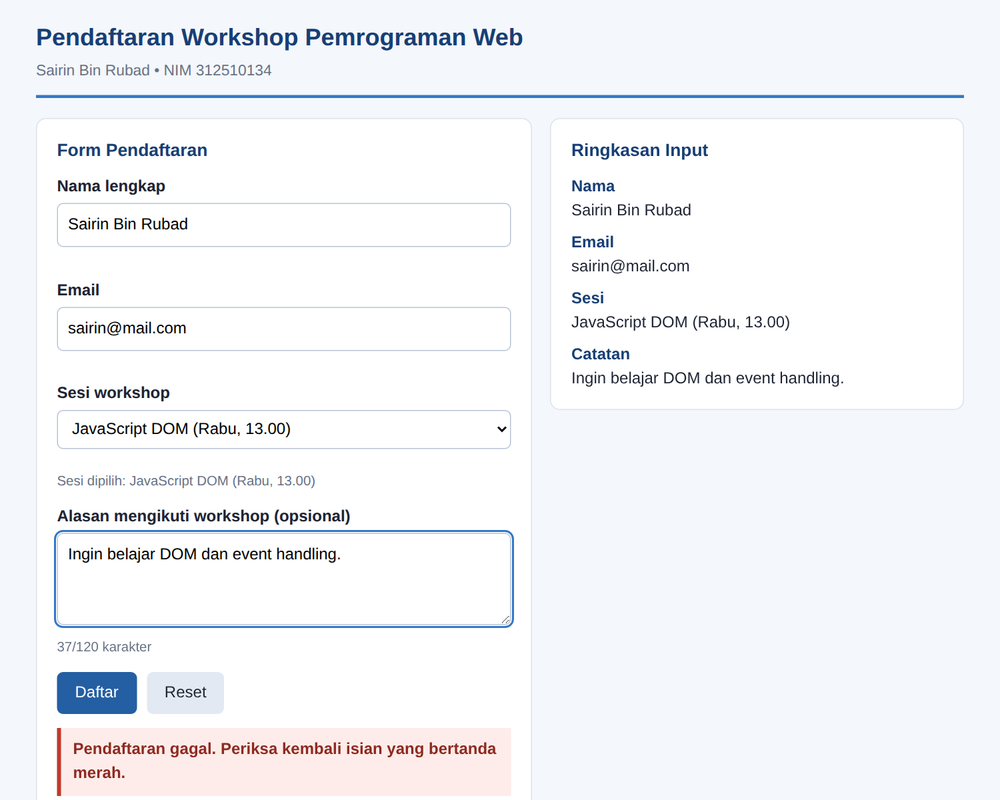

Setelah menekan "Daftar" dengan data valid (pesan sukses):

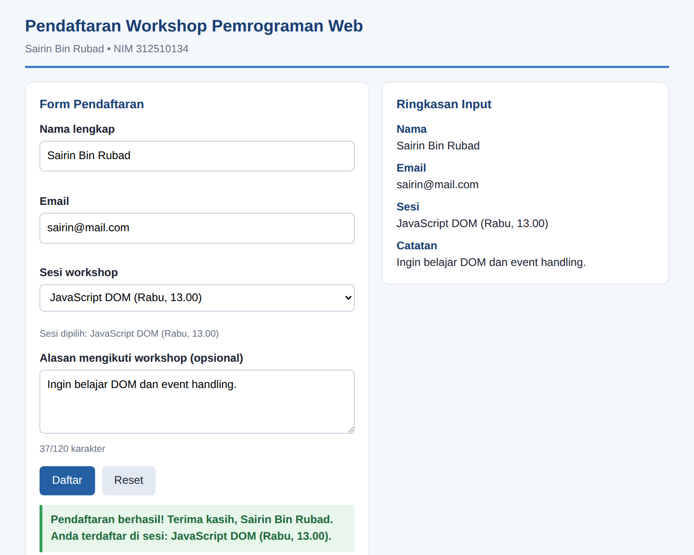

Setelah menekan "Reset":

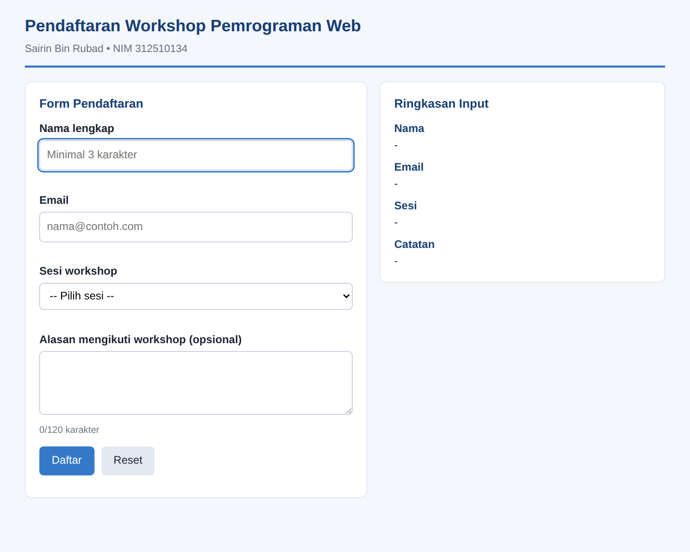

Tampilan pada perangkat mobile (layout satu kolom):

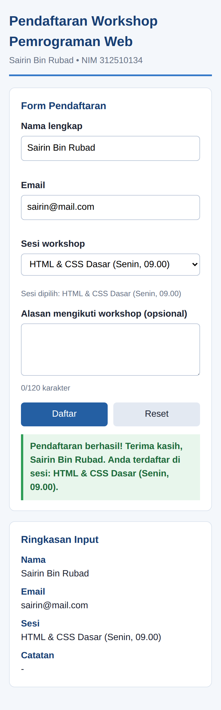

---

## 6. Eksperimen Mandiri

**1. Tombol hapus satu item pada To-do List** — sudah ditambahkan pada Latihan 6.

```js
const hapus = document.createElement("button");
hapus.type = "button";
hapus.className = "hapus";
hapus.textContent = "Hapus";
hapus.addEventListener("click", function () {
  item.remove();
  pesanTugas.textContent = "Tugas dihapus.";
});
item.append(label, selesai, hapus);
```

`item.remove()` menghapus elemen `<li>` dari DOM. Lihat screenshot Latihan 6 bagian "Tugas dihapus" di atas.

**2. Nama minimal tiga karakter** — diterapkan pada Mini Project (`else if (v.length < 3)`), lihat screenshot "Nama terlalu pendek" di atas.

**3. Event `change` pada dropdown sesi** — diterapkan pada Mini Project; sesi yang dipilih tampil di bawah dropdown dan pada ringkasan.

**4. Tombol sembunyikan/tampilkan paragraf dengan class CSS**

```css
.sembunyi { display: none; }
```

```js
tombolSembunyi.addEventListener("click", function () {
  const tersembunyi = paragrafEksperimen.classList.toggle("sembunyi");
  tombolSembunyi.textContent = tersembunyi ? "Tampilkan Paragraf" : "Sembunyikan Paragraf";
});
```

`classList.toggle()` mengembalikan `true` jika class baru ditambahkan, sehingga hasilnya dipakai untuk mengganti label tombol.

Paragraf tampil:

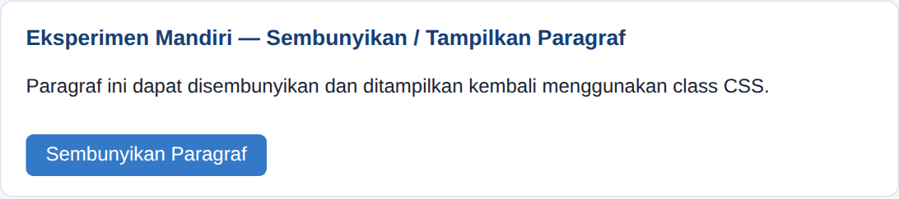

Paragraf disembunyikan:

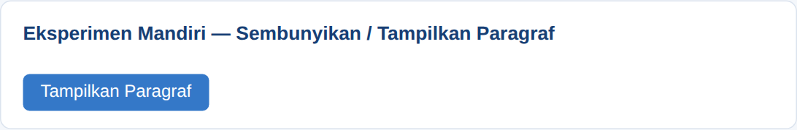

**5. Memindahkan script tanpa `defer` di `<head>`**

Percobaan: atribut `defer` dihapus sehingga menjadi `<script src="script.js"></script>` di dalam `<head>`.

Hasilnya, judul tetap *"Latihan DOM"* dan paragraf tetap *"Belum ada tindakan."* (tidak berubah), dan Console menampilkan error:

```
Uncaught TypeError: Cannot set properties of null (setting 'textContent')
```

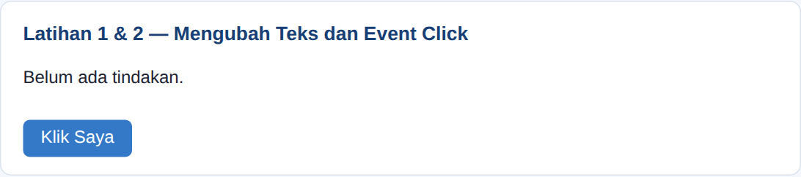

**Penyebab:** browser membaca HTML dari atas ke bawah. Skrip di `<head>` dijalankan sebelum elemen di `<body>` (seperti `#judul`) dibuat, sehingga `document.getElementById("judul")` mengembalikan `null`. Mengakses `null.textContent` menyebabkan error dan seluruh skrip berhenti. Atribut `defer` memerintahkan browser mengunduh skrip secara paralel namun menjalankannya setelah HTML selesai diparsing. Alternatif lain adalah menaruh `<script>` tepat sebelum `</body>` atau membungkus kode dengan event `DOMContentLoaded`.

---

## 7. Jawaban Pertanyaan Evaluasi

**1. Apa yang dimaksud dengan DOM dan apa manfaatnya?**
DOM (*Document Object Model*) adalah representasi dokumen HTML dalam bentuk pohon objek yang dapat diakses dan diubah oleh JavaScript. Manfaatnya: program dapat memilih elemen, mengubah teks/atribut/gaya, menambah atau menghapus elemen, serta merespons tindakan pengguna tanpa memuat ulang halaman.

**2. Apa perbedaan `getElementById()`, `querySelector()`, dan `querySelectorAll()`?**
- `getElementById("x")` memilih satu elemen berdasarkan `id` saja.
- `querySelector("selector")` memilih **elemen pertama** yang cocok dengan selector CSS (misal `#id`, `.kelas`, `tag`).
- `querySelectorAll("selector")` memilih **semua** elemen yang cocok dan mengembalikannya sebagai `NodeList`.

**3. Apa fungsi `addEventListener()` dan sebutkan tiga contoh event?**
`addEventListener()` menghubungkan sebuah event dengan fungsi (*handler*) yang dijalankan saat event itu terjadi, dan dapat dipasang lebih dari satu pada elemen yang sama. Contoh event: `click`, `input`, `submit` (juga `change`, `keydown`, `mouseover`).

**4. Mengapa `event.preventDefault()` digunakan pada event submit form?**
Perilaku bawaan submit adalah mengirim form dan memuat ulang halaman. Dengan `preventDefault()`, perilaku itu dibatalkan sehingga JavaScript dapat memeriksa data lebih dahulu dan menampilkan pesan validasi tanpa halaman hilang/di-refresh.

**5. Apa perbedaan `textContent` dan `innerHTML` dari sisi penggunaan dan keamanan?**
`textContent` membaca/menulis teks biasa; tag HTML yang diketik akan ditampilkan apa adanya sebagai teks. `innerHTML` membaca/menulis markup HTML sehingga dapat membuat elemen baru, tetapi jika diisi teks dari pengguna yang tidak dipercaya dapat menyisipkan skrip berbahaya (serangan **XSS**). Karena itu untuk menampilkan teks pengguna sebaiknya memakai `textContent`.

**6. Bagaimana `classList.toggle()` membantu mengubah tampilan elemen?**
`toggle()` menambahkan class bila belum ada dan menghapusnya bila sudah ada. Dengan satu tombol, tampilan elemen dapat berganti bolak-balik (misalnya highlight, mode gelap, sembunyi/tampil, tugas selesai) sementara gayanya tetap diatur di CSS.

**7. Sebutkan minimal tiga skenario pengujian validasi form.**
1. Semua kolom kosong → muncul pesan "wajib diisi".
2. Email tidak valid (misal `sairin@`) → muncul pesan format email salah.
3. Usia di bawah batas (misal 15) atau di atas 100 → muncul pesan rentang usia.
4. Nama hanya spasi / kurang dari 3 karakter (mini project) → ditolak.
5. Semua input valid → muncul pesan sukses dan form dikosongkan.

---

## 8. Kesimpulan

Melalui praktikum ini, saya mempelajari cara memilih dan memanipulasi elemen dengan DOM (`getElementById`, `textContent`, `classList`, `createElement`), menangani berbagai event (`click`, `input`, `change`, `submit`) memakai `addEventListener()`, serta membuat validasi form dan aplikasi interaktif sederhana (To-do List dan Form Pendaftaran Workshop). Atribut `defer` terbukti penting agar skrip berjalan setelah elemen HTML tersedia.
